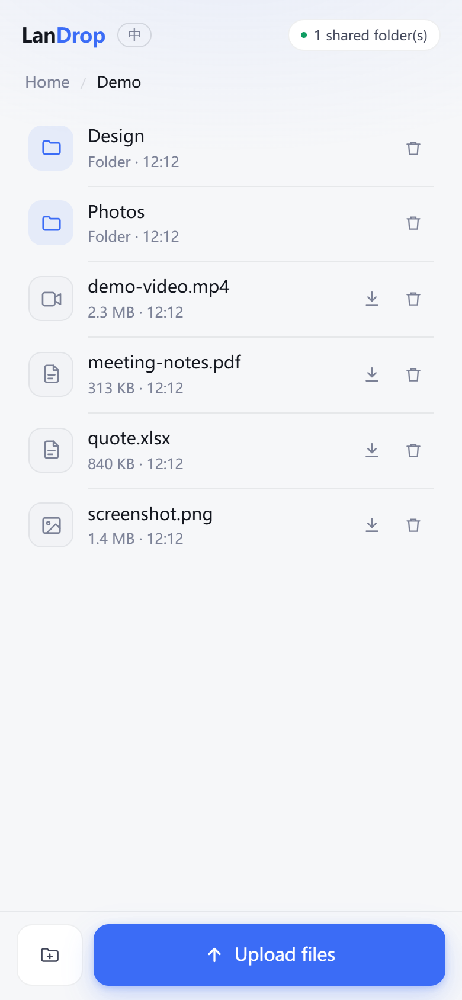
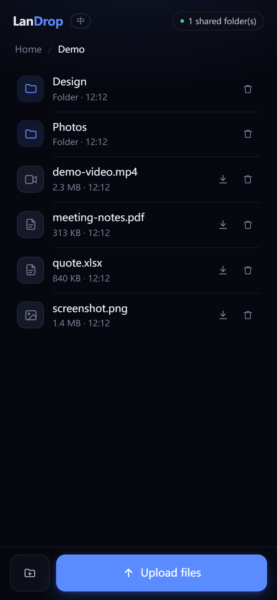
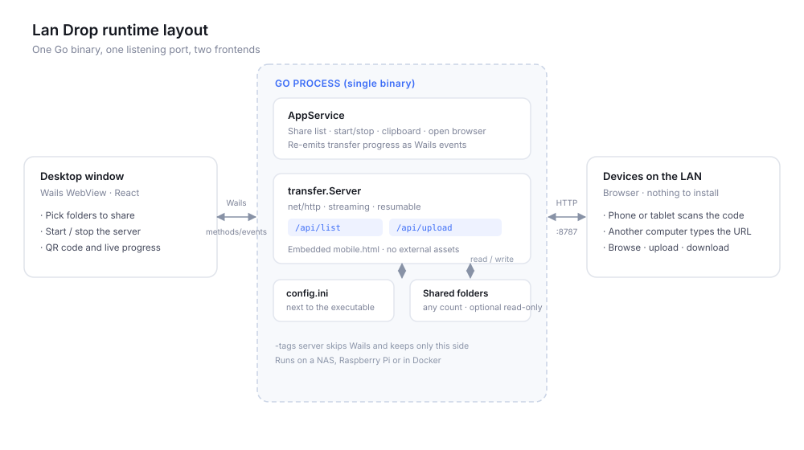

# Lan Drop

> Share a folder with every device on your network. No client, no account, no cloud.

**English** · [简体中文](README.zh-CN.md)

[](LICENSE)
[](go.mod)
[](https://v3.wails.io)
[](#quick-start)

Point Lan Drop at a folder and start the service. The other end opens a browser and gets the whole tree: browse, upload, download, and pick up an interrupted transfer where it stopped.

<p align="center">
  
  
</p>
<p align="center"><sub>The browser UI. Theme follows the system; language switches from the top bar.</sub></p>

**Written entirely by AI.** Every line of Go, TypeScript, CSS, build configuration and documentation in this repository was produced by an AI coding agent.

---

## Features

| | |
|---|---|
| **Nothing to install** | The other device only needs a browser. Scan the QR code or type the URL |
| **Multiple folders** | Every shared folder appears under one virtual root, browsable like a normal file tree |
| **Streaming transfers** | Constant 256 KB of memory. A 100 GB file costs the same as a 1 MB one |
| **Resumable** | Uploads continue via `X-Offset`; downloads use standard HTTP `Range`. Survives a dropped connection |
| **Live progress** | The desktop window shows direction, speed, elapsed time and the peer's IP for every transfer |
| **Read-only mode** | Serve files without letting the network write to them |
| **Two languages** | English and Simplified Chinese, detected on first launch and switchable at runtime |
| **Portable** | Settings live in `lan-drop.ini` next to the executable. Copy the folder, keep your setup |
| **Tray-resident** | Closing the window keeps the service running; quit from the tray menu to stop it |
| **Headless mode** | The same binary runs without a GUI on a NAS, a Raspberry Pi or in Docker |

## Why it is small

Lan Drop is a [Wails](https://v3.wails.io) v3 application: a Go backend and a
React frontend compiled into a single binary.

What matters is what it leaves out. Wails does not bundle a browser engine — it
drives the one already on the system: WebView2 on Windows, WKWebView on macOS,
WebKitGTK on Linux. No Chromium, no Node runtime, no `node_modules` at runtime.

The result is an executable of about 13 MB that starts instantly and idles at a
few tens of megabytes. An Electron app of comparable scope typically ships
100 MB or more before it touches a single one of your files.

## Quick start

### Download

Grab the file for your platform from [Releases](https://github.com/CyanHwang/lan-drop/releases):

- **Windows / Linux** — one executable, e.g. `Lan Drop-windows-amd64.exe`. Download it and run; there is nothing to unzip. Quote the name on Linux (`chmod +x "Lan Drop-linux-amd64"`)
- **macOS** — a `.dmg` disk image. Open it, drag Lan Drop to Applications, done.
  The build is unsigned, so the first launch needs a right-click → **Open**, or
  `xattr -dr com.apple.quarantine /Applications/lan-drop.app`

No installer, and no runtime to set up first.

On first launch the OS may ask for firewall or network permission. **You must allow it**, otherwise no other device can connect.

### Use it

1. Click **Add folder** and pick a directory (you can add several)
2. Click **Start service**
3. Connect your phone to the same Wi-Fi and scan the QR code

That is the whole flow. No accounts, no pairing, no third step.

### Build from source

Requires Go 1.26+, Node.js 18+ and the [Wails v3 CLI](https://v3.wails.io/getting-started/installation/).

```bash
git clone https://github.com/CyanHwang/lan-drop.git
cd lan-drop

# Development, with hot reload
wails3 dev

# Production build, output in bin/
wails3 build
```

The icon source is `build/appicon.svg`; run `wails3 generate icons` after editing it.

### Headless server

No GUI, just the HTTP service. Useful for a NAS, a Raspberry Pi or a container:

```bash
go build -tags server -o Lan-Drop-server .
./Lan-Drop-server -share /data/photos -share /data/docs
```

```
Lan Drop is running (read-write)

Shared folders (2):
  photos             /data/photos
  docs               /data/docs

Reachable at:
  http://127.0.0.1:57577
  http://192.168.1.10:57577

Press Ctrl+C to stop.
```

| Flag | Default | Description |
|---|---|---|
| `-addr` | `:57577` | Listen address: `:57577`, `0.0.0.0:9000`, `127.0.0.1:57577` |
| `-share` | none | Folder to share. Repeat the flag or separate with commas. Overrides the config file |
| `-config` | `lan-drop.ini` next to the binary | Config file path |
| `-readonly` | `false` | Reject uploads, mkdir and delete |
| `-auto-port` | `false` | Scan forward when the port is taken. Off by default so containers fail loudly instead of drifting |

With Docker:

```bash
docker build -f build/docker/Dockerfile.server -t lan-drop .
docker run --rm -p 57577:57577 -v /host/photos:/data/photos lan-drop -share /data/photos
```

## Configuration

Settings live in `lan-drop.ini` **next to the executable**, so the whole thing is portable. The desktop app writes this file when you add or remove a folder; editing it by hand works too.

```ini
; Lan Drop configuration file (portable)

[general]
language = en            ; en | zh-CN
show_hidden = false      ; include entries with the OS hidden attribute
show_dotfiles = false    ; include entries whose name starts with a dot
filter = *.tmp, node_modules   ; hide these from the listing

[share_1]
name = Downloads
path = D:\Downloads

[share_2]
name = Work
path = D:\Work\Docs
```

Both listing filters apply to folders as well as files, and both default to
`false`. `show_hidden` only has an effect on Windows, where files carry a hidden
attribute; on Unix a leading dot is the only convention, so `show_dotfiles`
covers it.

`filter` hides entries by name. Separate rules with commas or semicolons; each
rule is a literal name or a glob (`*`, `?`). Prefix a rule with `re:` to use a
regular expression, and put a single expression with no separators in it to
match against the whole input. Anything that does not compile is skipped, so a
typo never breaks the listing:

```ini
filter = *.tmp; node_modules; re:^\.(git|svn)$
```

See [`lan-drop.ini.example`](lan-drop.ini.example). The real `lan-drop.ini` is git-ignored — it holds machine-specific paths.

Older builds used `config.ini` in the same directory. On first launch the app
reads it once and writes `lan-drop.ini`; the old file is left untouched.

### Language

The OS language is detected on first launch and written to `lan-drop.ini`. From then on the stored value wins — changing your system locale will not flip the UI behind your back.

Two ways to switch:

- **Desktop window** — the language toggle in the top bar writes the choice back to `lan-drop.ini`
- **Browser UI** — a toggle in the top bar, remembered per browser in `localStorage`

The browser starts from the host's configured language. A manual choice in that browser wins, and it never writes to the host's config.

## HTTP API

The browser page and every endpoint share one port. No extra services.

| Method | Path | Description |
|---|---|---|
| GET | `/` | Browser UI |
| GET | `/api/list?share=&dir=` | Directory listing. Empty `share` returns the virtual root |
| GET | `/api/download?share=&path=` | Download, supports `Range` |
| GET | `/api/probe?share=&dir=&name=` | Bytes already received for a given file |
| PUT | `/api/upload?share=&dir=&name=` | Streaming upload. `X-Offset` sets the resume point |
| POST | `/api/mkdir?share=&dir=&name=` | Create a folder |
| DELETE | `/api/file?share=&path=` | Delete a file or an empty folder |
| GET | `/api/info` | Status, share count, read-only flag, language |

**Resume contract**: `X-Offset` must equal the exact byte count on disk. Otherwise the server returns `409` with the real size and the client restarts from there.

The browser client decides where to resume by asking how many bytes the server already holds for that *file name*. Picking a different file with the same name therefore continues from the wrong offset — there is no content hash to tell them apart.

There is no API version prefix and no CORS headers — the endpoints exist for the embedded page, not for third parties.

## Architecture



One process, two frontends:

- **Desktop** (React in a Wails WebView) picks folders, starts and stops the server, renders the QR code and shows live transfer progress.
- **Browser** (a single-page HTML file embedded in the Go binary) handles browsing, uploading and downloading on the phone. It is served by the LAN listener, not by the WebView asset handler.

Both share one `transfer.Server`, which is why the desktop window can show progress for uploads coming from a phone — pushed back as the `transfer:progress` Wails event.

```
main.go              Wails entry point: tray, single instance, window lifecycle
appservice.go        Service exposed to the frontend: folders, start/stop, clipboard
main_server.go       -tags server entry point: plain HTTP, no GUI
internal/config      lan-drop.ini read/write, legacy migrations
internal/i18n        Message catalogue and OS language detection
internal/transfer    HTTP server, path validation, streaming, progress
  server.go          Listener lifecycle, routing, path resolution
  handlers.go        The seven endpoints
  netutil.go         Port probing, LAN address ranking
  mobile.html        The embedded browser UI
```

## Security

**There is no authentication.** Any device on the same subnet that knows the address can read and write the shared folders. That is what makes it convenient, and it is also the only real risk.

- Use it on networks you trust — home, or your own hotspot. Not on office or public Wi-Fi
- Sharing with a device you do not trust? Start with `-readonly`; write endpoints return `403`
- Paths are validated twice: lexically against `../`, then through symlink resolution that also covers **not-yet-existing** upload targets
- Absolute host paths are never sent to clients — the browser only sees folder names
- The activity list shows each peer's IP and a short device hint derived from `User-Agent`. Both come from the connection itself, are never written to disk, and disappear when the app exits
- Delete only removes files and empty directories. `os.Remove` is not recursive, and the share root itself is refused

Found a security issue? Open an [issue](https://github.com/CyanHwang/lan-drop/issues) without public exploit details.

## Development

```bash
go test ./...              # unit tests
go test ./... -short       # skip the 256 MB throughput test
go vet ./...
go build -tags server .    # verify the headless build
```

Coverage includes path traversal, symlink escapes, cross-share isolation, resume conflicts, `Range` downloads, read-only mode and the translation catalogue.

The generated Wails bindings under `frontend/bindings` are committed so a fresh
clone builds without the CLI. After changing an exported Go method, run
`wails3 generate bindings -ts` and commit the result.

Release notes live in `.github/release-notes/<tag>.md` (for example
`v0.1.0.md`). A version without a note there falls back to GitHub's
auto-generated release notes.

## Roadmap

- [ ] Post-transfer verification (size plus optional hash)
- [ ] Per-share read-only / read-write toggle
- [ ] Optional access password
- [ ] Persistent transfer history

## License

[MIT](LICENSE)
