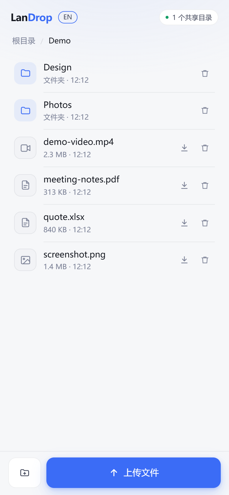
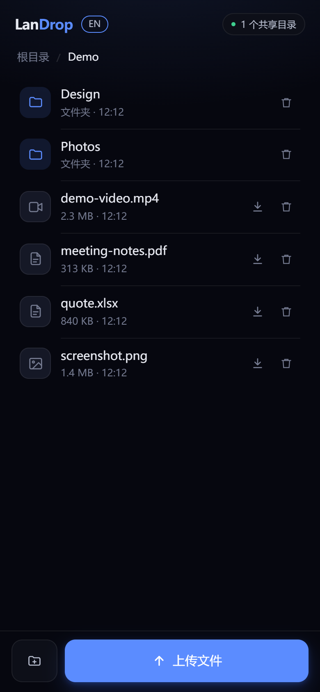
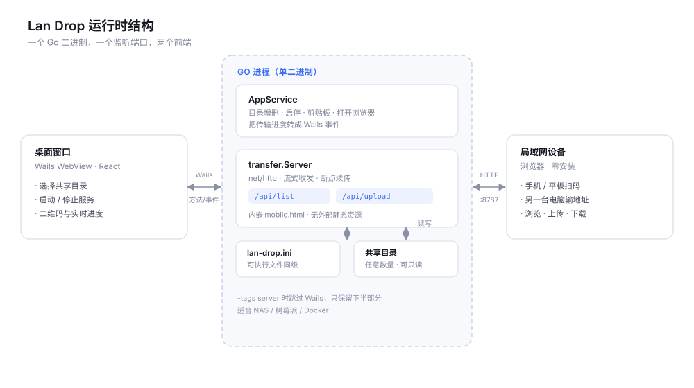

# Lan Drop · 局域网快传

> 把一个文件夹分享给局域网里的每台设备。不装客户端，不注册，不经过云端。

[English](README.md) · **简体中文**

[](LICENSE)
[](go.mod)
[](https://v3.wails.io)
[](#快速开始)

指定一个文件夹，启动服务。对端打开浏览器就能看到完整的目录树：浏览、上传、下载，中断的传输可以接着传。

<p align="center">
  
  
</p>
<p align="center"><sub>浏览器端界面。主题跟随系统，语言可在顶栏切换。</sub></p>

---

## 特性

| | |
|---|---|
| **零客户端** | 对端只需要浏览器。手机扫码、电脑输地址，打开就能用 |
| **多目录共享** | 多个文件夹呈现为一个虚拟根目录，像浏览文件夹一样点进去 |
| **流式传输** | 恒定 256 KB 内存占用，单文件大小不受限制，100 GB 也不吃内存 |
| **断点续传** | 上传按 `X-Offset` 续传，下载走标准 HTTP `Range`，断网重连接着传 |
| **实时进度** | 桌面端显示每个传输的方向、速度、耗时和对端 IP |
| **只读模式** | 只给人看，不让网络改你的文件 |
| **中英双语** | 首次启动自动检测，运行时可切换 |
| **绿色便携** | 配置存在可执行文件同级的 `config.ini`，拷走即用 |
| **常驻托盘** | 关闭窗口不退出，服务继续运行；从托盘菜单退出才停止 |
| **服务端模式** | 同一个二进制可以不带 GUI 跑在 NAS、树莓派或 Docker 里 |

## 为什么这么小

Lan Drop 是一个 [Wails](https://v3.wails.io) v3 应用：Go 写后端，React 写界面，编译成单个二进制。

关键在于它**不含**什么。Wails 不打包浏览器内核，而是驱动系统已有的那个：Windows 上是
WebView2，macOS 上是 WKWebView，Linux 上是 WebKitGTK。没有 Chromium，没有 Node
运行时，运行时也不需要 `node_modules`。

结果是一个约 13 MB 的可执行文件，启动即开，空闲时只占几十兆内存。同等功能的 Electron
应用通常在 100 MB 以上，还没算上你的数据。

## 快速开始

### 下载安装

到 [Releases](https://github.com/CyanHwang/lan-drop/releases) 下载对应平台的文件：

- **Windows / Linux** —— 单个可执行文件（如 `Lan Drop-windows-amd64.exe`），下载后直接运行，不用解压。Linux 下文件名含空格，命令里记得加引号
- **macOS** —— `.dmg` 磁盘映像，打开后把 Lan Drop 拖进「应用程序」即可。
  构建未做代码签名，首次启动需要右键 →「打开」，或执行
  `xattr -dr com.apple.quarantine /Applications/lan-drop.app`

不需要安装器，也不用预先装任何运行时。

首次启动时系统可能弹出防火墙提示，**必须允许**，否则其它设备连不上。

### 使用

1. 点「添加文件夹」，选一个要共享的目录（可以加多个）
2. 点「启动服务」
3. 手机连同一个 WiFi，扫二维码或输入界面上显示的地址

传文件就是拖进去、点下载，没有第三步。

### 从源码构建

需要 Go 1.26+、Node.js 18+、[Wails v3 CLI](https://v3.wails.io/getting-started/installation/)。

```bash
git clone https://github.com/CyanHwang/lan-drop.git
cd lan-drop

# 开发模式（热重载）
wails3 dev

# 生产构建，产物在 bin/
wails3 build
```

图标源文件是 `build/appicon.svg`，改动后运行 `wails3 generate icons` 重新生成。

### 服务端模式（无 GUI）

不带桌面界面，只跑 HTTP 服务，适合 NAS、树莓派、容器：

```bash
go build -tags server -o Lan-Drop-server .
./Lan-Drop-server -share /data/photos -share /data/docs
```

```
Lan Drop 服务已启动（读写模式）

共享目录 2 个：
  photos             /data/photos
  docs               /data/docs

访问地址：
  http://127.0.0.1:57577
  http://192.168.1.10:57577

按 Ctrl+C 停止。
```

参数：

| 参数 | 默认值 | 说明 |
|---|---|---|
| `-addr` | `:57577` | 监听地址，支持 `:57577`、`0.0.0.0:9000`、`127.0.0.1:57577` |
| `-share` | 无 | 共享目录，可重复或用逗号分隔；指定后忽略配置文件 |
| `-config` | 可执行文件同级 `config.ini` | 配置文件路径 |
| `-readonly` | `false` | 只读模式：禁止上传、新建文件夹、删除 |
| `-auto-port` | `false` | 端口被占用时自动向后找；默认直接报错，避免端口漂移 |

也可以直接用 Docker：

```bash
docker build -f build/docker/Dockerfile.server -t lan-drop .
docker run --rm -p 57577:57577 -v /host/photos:/data/photos lan-drop -share /data/photos
```

## 配置文件

配置存在**可执行文件同级**的 `config.ini` 里，纯绿色便携。桌面端添加文件夹时会自动写入，也可以直接用记事本改：

```ini
; Lan Drop 局域网快传配置文件

[general]
language = en            ; en | zh-CN
show_hidden = false      ; 显示带系统隐藏属性的项
show_dotfiles = false    ; 显示以 . 开头的项
filter = *.tmp, node_modules   ; 从列表中隐藏这些

[share_1]
name = 下载
path = D:\Downloads

[share_2]
name = 工作文档
path = D:\Work\Docs
```

两个列表过滤开关对文件和文件夹同时生效，默认都是 `false`。`show_hidden` 只在
Windows 上有意义——那里的文件带隐藏属性；Unix 没有这个概念，点开头是唯一的约定，
由 `show_dotfiles` 控制。

`filter` 按名称隐藏条目。规则之间用逗号或分号分隔，每条是名称或通配符
（`*`、`?`）；`re:` 开头的规则按正则解释，整条不含分隔符时也可以直接写一条正则。
任何无法编译的规则都会被跳过，写错不会让列表挂掉：

```ini
filter = *.tmp; node_modules; re:^\.(git|svn)$
```

模板见 [`config.ini.example`](config.ini.example)。真正的 `config.ini` 在 `.gitignore` 里——它存的是本机路径，不该进版本库。

### 语言

首次启动时检测操作系统语言并写入 `config.ini`，之后一律以配置里的值为准——改了系统语言也不会在背后把界面换掉。

两处可以切换：

- **桌面窗口** —— 顶栏的下拉框，选择会写回 `config.ini`
- **浏览器端** —— 顶栏的切换按钮，按浏览器记在 `localStorage`

浏览器默认使用主机的语言配置；在该浏览器里手动选过就以手动选择为准，且不会写回主机配置。

## HTTP 接口

手机端页面和所有接口由同一个监听端口提供，没有额外依赖。

| 方法 | 路径 | 说明 |
|---|---|---|
| GET | `/` | 浏览器界面 |
| GET | `/api/list?share=&dir=` | 目录列表；`share` 为空时返回虚拟根 |
| GET | `/api/download?share=&path=` | 下载，支持 `Range` |
| GET | `/api/probe?share=&dir=&name=` | 查询服务器上已收到的字节数 |
| PUT | `/api/upload?share=&dir=&name=` | 流式上传，`X-Offset` 指定续传起点 |
| POST | `/api/mkdir?share=&dir=&name=` | 新建文件夹 |
| DELETE | `/api/file?share=&path=` | 删除文件或空目录 |
| GET | `/api/info` | 运行状态、共享目录数量、是否只读、当前语言 |

**续传约定**：`X-Offset` 必须等于磁盘上的实际字节数，否则服务端返回 `409` 并附上真实大小，客户端据此重来。

浏览器端靠「这个文件名下服务端已有多少字节」来决定从哪续传。因此换一个同名但内容不同的文件，会从错误的位置接着写——没有内容哈希可以区分。

接口没有版本前缀，也没有 CORS 头——它只服务于内嵌页面，不打算被第三方调用。

## 架构



一个进程，两个前端：

- **桌面端**（React + Wails WebView）负责选目录、启停服务、展示二维码和传输进度。
- **浏览器端**（内嵌在 Go 二进制里的单页 HTML）负责手机上的浏览、上传、下载。它由 `internal/transfer` 的 `go:embed` 打包，走局域网 HTTP 监听器，不经过 WebView 的 asset handler。

两者共享同一个 `transfer.Server`，所以桌面端能看到手机上传的实时进度——通过 `transfer:progress` 事件推回 WebView。

```
main.go              Wails 应用入口：托盘、单实例、窗口生命周期
appservice.go        暴露给前端的服务：目录增删、启停、剪贴板
main_server.go       -tags server 时的入口：纯 HTTP，无 GUI
internal/config      config.ini 读写与老版本 JSON 迁移
internal/i18n        消息表与系统语言检测
internal/transfer    HTTP 服务、路径校验、流式收发、进度上报
  server.go          监听器生命周期、路由注册、路径解析
  handlers.go        7 个接口的实现
  netutil.go         端口探测、局域网 IP 排序
  mobile.html        内嵌的浏览器端单页
```

## 安全说明

**没有鉴权。** 同一网段内任何知道地址的设备都能读写共享目录。这既是它好用的原因，也是它唯一的风险。

- 只在可信网络（家里、自己开的热点）使用，别在公司网络或公共 WiFi 上开
- 需要给不信任的设备看文件时，用 `-readonly` 启动，写接口会直接返回 403
- 路径做了两层校验：先做词法归一化拦截 `../`，再解析符号链接（包括**尚不存在**的上传目标）确保没有跳出共享根
- 共享目录的绝对路径不会下发给远端，浏览器只看到目录名
- 传输活动里显示对端 IP 和由 `User-Agent` 推断的简短设备标签，两者都来自当前连接，不会写入磁盘，关闭软件即消失
- 删除只允许文件和空目录，`os.Remove` 不做递归删除，共享根本身拒绝删除

发现安全问题请开 [Issue](https://github.com/CyanHwang/lan-drop/issues)，不要公开利用细节。

## 开发

```bash
go test ./...              # 单元测试
go test ./... -short       # 跳过 256 MB 吞吐测试
go vet ./...
go build -tags server .    # 验证服务端模式
```

测试覆盖路径穿越、符号链接逃逸、跨共享隔离、续传 409、Range 下载、只读模式，以及翻译表完整性。

## 路线图

- [ ] 传输完成后自动校验（大小 + 可选哈希）
- [ ] 共享目录级别的只读 / 读写开关
- [ ] 可选的访问口令
- [ ] 传输历史持久化

## 许可证

[MIT](LICENSE)
